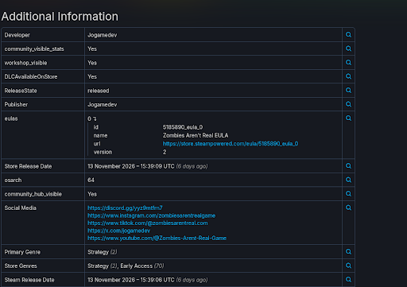

# Project 02 Proposal: Game sales by genre.

**Team members:** Robert Williams

See the [Project 02 instructions](https://data385.github.io/project/proj02_wholegame.html) for what goes in each section. Bullet points are great. Put any images in an `img/` folder.

## 1. Problem statement

_Who has the problem, what decision or need it involves, why it matters, and what you expect to find._

Video Games have become increasingly unoptimized or some aren't selling all that well due to region or the platform. 
For a company to design a video game and find an audience they need to know what platforms are available and genre's that are popular in different platforms and regions.

What I expect to find is common stuff like family games being most sold on Nintendo consoles and fps shooters to be sold on Microsoft's Xbox. Perhaps there
will be some surprises like some games not selling all that well anyways despite being the right genre. Perhaps due to marketing or quality of the game.

## 2. Research question

_A clear association between a response and at least one predictor variable._

response: population / sales
predictor: genre / platform

My response variable will be the number of sales. My predictor variable will be what platform, genre or region those sales were made in.

## 3. Data acquisition

_In 1-2 sentences, describe the data you intend to collect and how you will get it._

I will use an api key from steamdb to collect data from steams open sales figures for their games. The other websites are either not ideal or it is locked behind a subscription.
https://steamdb.info/

Turns out these websites aren't viable.
I intend to use API's from this website https://www.vgchartz.com/ as well as this website https://www.gameye.app/category/games. vgchartz gives datasets and gameye
has some spreadsheets that I can utilize.

### a. Confirm viability

_Scraping: summarize the "Before You Scrape" checklist. Downloading: citation, link to the documentation, and how the data were originally collected. Collecting it yourself: how you are collecting it and where you are storing it._

For steamdb Status: viable
1.
  - robots.txt Seems to have different rules for different bots. Most bots are restricted for the root directory of the url.
2.
  - Data can be accessed through the websites API key. Most of the terms of use is permissable where scraping is allowed on the website if given permission. 
  Otherwise a lot of it can be acquired from steam itself.
3.
  - Anything provided is allowed. There are permissions for scraping the website itself. The data on the site isn't about people but charts for game sales
  so it shouldn't be anything sensitive.
4.
  - Scraping is allowed if given permission.
5.
  . I can scrape the website if given permission. Otherwise I can use an api key provided by steam or steamdb.

For vgchartz.com not viable propietary
1.
  - robots.txt seems to allow all agents to use it as long as it uses a certain .xml file. Which links to different websites in which bots can scrape.
2.
  - The terms of service explictly says. "You agree not to use any automated means, 
  including, without limitation, agents, robots, scripts, or spiders, to access, monitor, 
  or copy any part of our sites, except those automated means that we have approved in advance and in writing."
  - Any means approved is allowed so using the .xml from robots.txt should be fine as it is given to us for our scripts.
3.
  - Anything provided is allowed. The data on the site isn't about people but charts for game sales.
4.
  - Scraping isn't allowed as we are given a method of getting data from the site through a .xml url.
5.
  The alternative isn't really going to give me any data so I wouldn't use this website as the API keys seem to be used for enterprise use.
  
For GAMEEYE website Not viable. Isn't really what i am looking for.
1. 
  - robots.txt tells me that you cannot use ai bots to scrape the website. Everything is behind a signing up for the website to gain access to the api.
  - In the comments for robots.txt it says "crawlable; everything else is either an API, behind a login, or per user UI."
2. 
  - Terms of service doesn't say anything about scraping that I can find however it seems the website provides api keys for those who have accounts set up.
3. 
  - The data isn't really sensitive and it is pretty much public from what you can see provided. It isn't about people but video games and their sales.
4. 
  - I think I can just use an API key so it would only be one. Things can update though.
5.
There is an API key. I don't need to make requests to the http server.

### b. Variables of interest

  - Platform
    - Data type: String
    - Description: The platforms that the game was released on.
  - Genere
    - Data type: String
    - Description: The Genres the game belongs to.
  - Release Date
    - Data type: Date
    - Description: The Date the game was released per platform or just the earliest.
  - Console
    - Data type: String
    - Description: Console released on.
  - Sales
    - Data type: Int
    - Description: Sales if known.

_If you do not have the data yet, list the variables you plan to collect and the exact question text. Include 1) the variable name, 2) data type 3) description. Use bullet points._

I don't have the data yet. 

## 4. Data example

_Scraping: a URL and an annotated screenshot. Downloading: a link to your rendered `data_management.pdf` with `glimpse()`. Collecting: a screenshot of one example row._

## 5. EDA

_The techniques and functions you plan to use to import, wrangle, visualize, and explore the data, and why each is needed._

I will definitely try to use facet_wrap or facet_grid to visualize different categories.

  - First I will utilize steams API to import some of the data.
  - To wrangle I haven't looked at what it entails yet but I think I will definitely have to cut some things out.
  - Visualization would be to show different types of graphs in different categories.
    - Compare different genres of games on steam.
    - Perhaps compare it to different platforms on the PC market that are available if they aren't proprietary or require a 
    subscription.
  - A difficult I found when trying to find websites for data is that a lot of the ones that can be used are locked behind a subscription.
  Essentially making it so that Publications, Journalists or Enterprises can utilize them.
  - Another difficult I may face is trying to get sales for different console platforms as not all sales for all of the games have been released publically by
  the companies that made them or the publishers.
## 6. Modeling

_The models you plan to use, your response and predictor variables, and why the models fit your research question._

My response variable is the sales.
The predictor variables are genre, platform and region.
I will go for a Histograms, barcharts boxplots as well as scatterplots.

I think these models fit my research question well has I will be using categorical data and trying to show sales over a period of time on different platforms.

## 7. Communicate

_How you plan to present your results (website, poster, or short slide presentation)._

A short slide presentation would be what I may go for.

## 8. LLM disclaimer

_Whether and how you will use AI tools: the specific tool, its use, and your data protection methods. If you won't use any, say so._

If I use any AI it would be to find sources or websites that may have the data I need. I won't use AI to scrape or write code otherwise.
